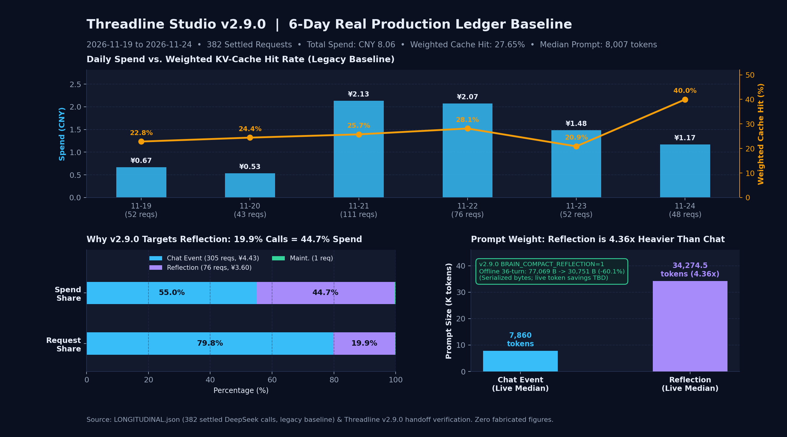

# Threadline Studio (`v2.9.0`)

<p align="center">
  
</p>

<p align="center">
  <strong>A continuity-first living brain &amp; multi-resident desktop studio for AI companions, desktop pets, digital humans, and work agents.</strong><br/>
  一颗长期连贯、会做梦、有情绪、零依赖、可同时养多位数字生命的开源个人大脑桌面软件。
</p>

<p align="center">
  
  
  
  
</p>

---

> **核心理念**：*“一颗活生生的数字生命大脑，伪装成标准 API；而不是一个空壳 API，假装自己有灵魂。”*  
> 本地常驻 `127.0.0.1`，一套原生 SQLite 记忆与 Limbic 情绪底座，把同一位数字生命无缝接到你的桌面控制台、VTuber、SillyTavern、QQ 或任意 OpenAI 兼容客户端。

## 为什么做 Threadline？

大多数 AI 陪伴和 Agent 项目，要么是换个壳的聊天窗口（聊长了就忘、换个前端就失忆），要么是动辄几十个依赖、月烧几百块的云端黑盒。Threadline Studio 把这件事做成了一款**真正属于你本机的轻量个人大脑**：

- **长期连贯的记忆与做梦系统**：原生 `node:sqlite` 持久化，不可变 `event` 账本 + 带版本乐观锁与来源追溯的 `note` / `personal_state` + 后台反思与 Auto-Dream 巩固，聊得越久越记得你。
- **真正软件化的桌面控制台（Tauri v2）**：内置 `desktop-app/` 原生壳工程（无地址栏、系统托盘常驻、关窗后台继续做梦）与 `.github/workflows/release-tauri-installer.yml`，推送 Tag 自动产出 Windows 可选路径 NSIS `.exe`、macOS `.dmg` 与 Linux 安装包。
- **三大界面皮肤 + 2D/3D 记忆星图**：顶部一键切换 **通用 · 清雅风** / **画报 · 温暖风** / **极客 · VS Code 风**，内置零依赖 2D/3D 可旋转记忆星图与透明鲸鱼娘看板娘。
- **多数字生命档案 + 严格隐私与安全闸门**：每位居民独立目录、独立 SQLite 与情绪曲线，绝不串记忆；API Key 仅驻留内存从不落盘；内置感官隐私闸门（默认关闭、支持金融/无痕黑名单与窗帘模式）、AES-256-GCM 加密时间胶囊备份与多格式历史记忆导入（QQ / 微信 / Markdown / JSON）。
- **零第三方核心依赖 & Fail-Closed 工程纪律**：`src/` 目录 0 外部 npm 依赖，严格 `127.0.0.1` 回环与本地 CSP；未验证能力绝不静默降级，内部思考链 `reasoning_content` 绝不外泄。

## 历史账本基准（覆盖 6 个 UTC 日期）

历史样本包含 `2026-11-19` 至 `2026-11-24` 六个 UTC 日期中的 382 笔已结算 DeepSeek 调用，首尾日期均为部分日。¥8.06 来自账本按用量估算。历史行缺少排版标记，图中的 Legacy 仅作历史基线标签。

<p align="center">
  
</p>

| 指标（历史基准，382 笔已结算调用） | 日常聊天 (`event`) | 后台反思 (`reflection`) | 全部汇总 |
| --- | ---: | ---: | ---: |
| 调用次数 / 占比 | 305 次（79.8%） | 76 次（19.9%） | 382 次（含 1 次维护） |
| 6 天累计费用（按用量估算） | ¥4.43（55.0%） | **¥3.60（44.7%）** | **¥8.06** |
| 中位输入长度 | 7,860 tokens | **34,274.5 tokens** | 8,007 tokens |
| 加权上下文缓存命中率 | 22.31% | 33.54% | 27.65% |

正是基于这份真实账本定位到“**不到 20% 的反思调用吃掉近 45% 的费用**”，`v2.9.0` 推出了三项**默认关闭、可独立开关与量化对照**的性能实验能力：

- `staged-v1`（缓存前缀排版）：稳定人设、风格与工具契约前置，时间/状态/权限等易变字段后置；同样覆盖普通反思。
- `BRAIN_COMPACT_REFLECTION=1`（增量记忆反思）：按上次已提交反思的入账边界收窄普通对话时间线，保留同毫秒与迟到事件及固定材料。在 36 条合成对话离线样例中，完整包体积从 `77,069 B` 降至 `30,751 B`（**-60.1%** 序列化体积；真实多日 token 收益待线上对照确认）。
- `BRAIN_UPSTREAM_SSE=1`（上游流式测量）与 `BRAIN_FAST_CHAT=1`（可选真流式快轨 `<model>:fast-chat`）：快轨仅传静态居民设定与调用方历史、关闭思考、安全边界分段直出并做密钥脱敏，不写 Event/Decision/记忆，由调用方显式选择；完整心智入口仍坚持事务提交后交付。

> 完整测量方法、探针命令与对照原则见 [`docs/API-PERFORMANCE.md`](docs/API-PERFORMANCE.md)。

## 3 分钟快速开始

### 1. 桌面直启（推荐）
- **Windows**：双击 `Start-Threadline.cmd`（或从 GitHub Releases 下载 NSIS `.exe` 安装器）
- **macOS**：双击 `Start-Threadline.command`
- **Linux**：运行 `./Start-Threadline.sh`
- **无界面后台服务**：`node tools/brain-service/run.mjs`（配置见 [`docs/CONFIGURATION.md`](docs/CONFIGURATION.md)）

### 2. 运行全套自检（1,304 项测试）

Studio、Brain、`doctor` 和默认回归均以 **Node 26.8.0 或更新的稳定版**为门槛。Windows 实测 Node 22.22.0 和 24.13.0 均能打开原生 SQLite，但完整回归在启动门槛处以 `NODE_VERSION` 退出。Node 26.12.1 通过全量测试。
```bash
npm test
```

### 3. 开启 v2.9.0 性能实验开关（可选）
```bash
# 上游流式首段耗时采集 + 增量记忆反思 + 可选快轨
BRAIN_UPSTREAM_SSE=1 BRAIN_COMPACT_REFLECTION=1 BRAIN_FAST_CHAT=1 npm run desktop
```

### 4. 量化对照你的真实账本（只读）
```bash
node tools/ops/compare-wire-layout.mjs <journal.json> --markdown
node tools/ops/bench-api-channels.mjs <journal.json> --markdown
```

## 生态万能插口

开启本地网关后，持主人凭证即可通过标准 OpenAI 兼容接口接入外部前端（`/v1/protocols` 可查询能力）。`BRAIN_WORK_CHANNEL=1` 可启用试验性非流式 `:work`，只透传调用方声明的工具协议。`:raw` 继续关闭。

- **桌面数字人 / VTuber**：Open-LLM-VTuber、Fay、Project AIRI
- **角色扮演与多端聊天**：SillyTavern、Cherry Studio、QQ 桥接（`npm run qq`）、AstrBot
- **软件管家与协作**：内置 `threadline-patch-v1` 审批卡协议（先展示改前→改后，经你确认才落地）

详细接入配方见 [`docs/ECOSYSTEM-BRIDGES.md`](docs/ECOSYSTEM-BRIDGES.md) 与 [`docs/MIND-PROTOCOL-SPEC.md`](docs/MIND-PROTOCOL-SPEC.md)。DSH 需要经核验的独立执行器，内置 Studio 当前保留关闭。适配契约和验证记录见 [后端交接](docs/BACKEND-HANDOFF-V290.md)。

## 仓库导览（新用户怎么看这 600+ 个文件）

| 目录 | 用途 | 适合谁看 |
| --- | --- | --- |
| `src/` | 零依赖核心大脑引擎（存储、认知、情绪、网关、安全、胶囊、导入） | 架构与核心开发者 |
| `scripts/local-desktop.mjs` & `scripts/desktop-ui/` | Studio 桌面控制台后端与三套皮肤 / 3D 星图界面 | 前端与桌面交互定制 |
| `desktop-app/` | Tauri v2 原生桌面打包壳与 NSIS 安装器配置 | 客户端打包与发布 |
| `docs/` | 架构、配置、隐私、记忆导入、生态接入与 API 性能核验文档 | 所有用户 |
| `tools/` | 后台守护服务、QQ 桥接、账本分析与 API 压测探针 | 运维与性能实测 |
| `test/` | 132 个测试文件、1,304 项自动化验证 | 回归验证 |
| `prompts/archive/` & `experiments/` | 历史提示词演化归档与科研对比实验（不影响主运行） | 深度研究者 |

## 构建 Windows 原生安装包

推送版本 Tag 会触发 `.github/workflows/release-tauri-installer.yml` 自动打包并校验 `.exe` 产物。如需本地手动构建：准备 Rust/MSVC 与 Windows SDK，将 Node 26.8+ 便携包解压至根目录 `runtime/node/`，在 `desktop-app/` 中执行 `npm install && npm run build -- --bundles nsis`。

## License

MIT — 详见 [`LICENSE`](LICENSE) 与 [`THIRD_PARTY_NOTICES.md`](THIRD_PARTY_NOTICES.md)。
