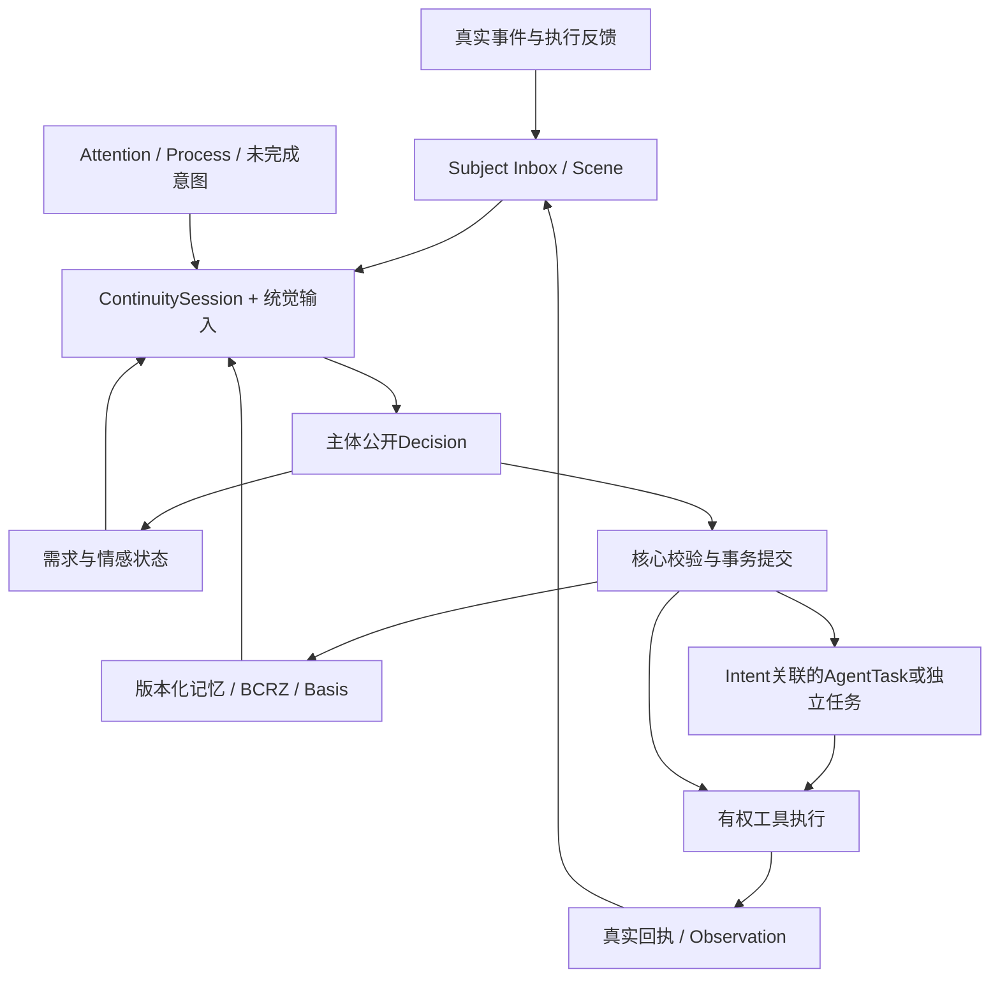

# 架构与职责

Event是实际遇见或明确报告的来源；Note和personal_state分别承载可检索材料与主体认识，保留固定版本及依据。目录摘要不等于正文已交付；保存不等于模型实际使用；提出操作不等于执行。

Intent负责目标，Decision负责本次选择，AgentTask负责具体执行，Process维持相关过程。Task完成不自动证明主体目标完成；不得按相似目标猜测Intent归属。

模型负责认识、意图、解释、使用条件与下一步。程序负责确定性结构、来源、版本、授权、预算和回执，不能替主体补造经历或成功。允许wait、不回复、保留未决问题。

Limbic只提供确定性需求/情绪演化。LLM提交事件评价，Worker不接数据库、不调用模型；Node在现有事务中提交状态。它不替代统觉、记忆或决策。

V3运行环境提供显式授权下的能力说明、参数契约与结果语义。费用明确、尚未采用的机械格式错误最多一次纠错，原始公开草稿/材料与独立尝试费用保留；权限、版本、证据与未知副作用保护不因此放宽。

空闲认知复用既有反思入口，由主体选择Intent、任务、查阅或等待；不引入第二个Planner，也不靠随机任务强迫行动。Experience Learning保留现有可选代码，默认关闭；工程回归不证明真实模型已学会自主学习。
